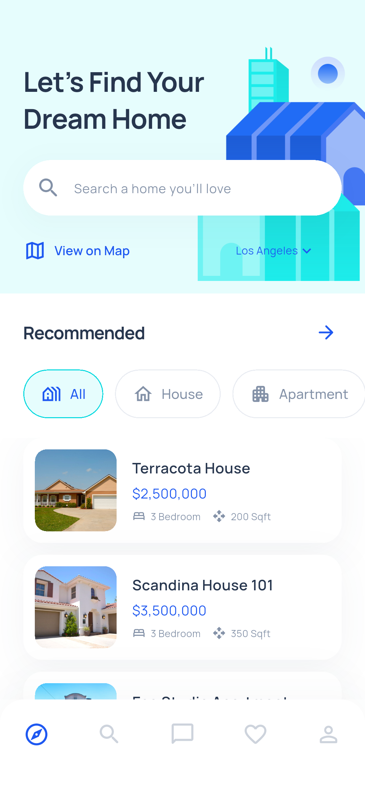
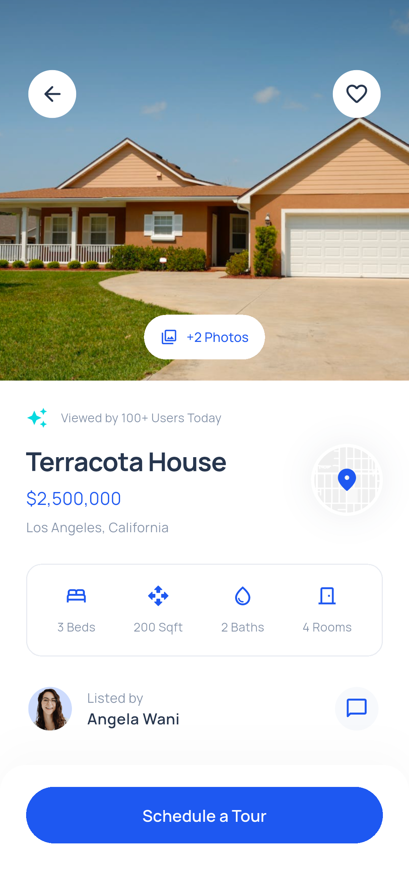
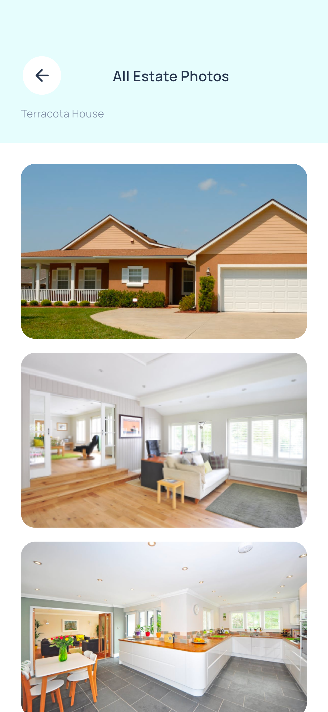
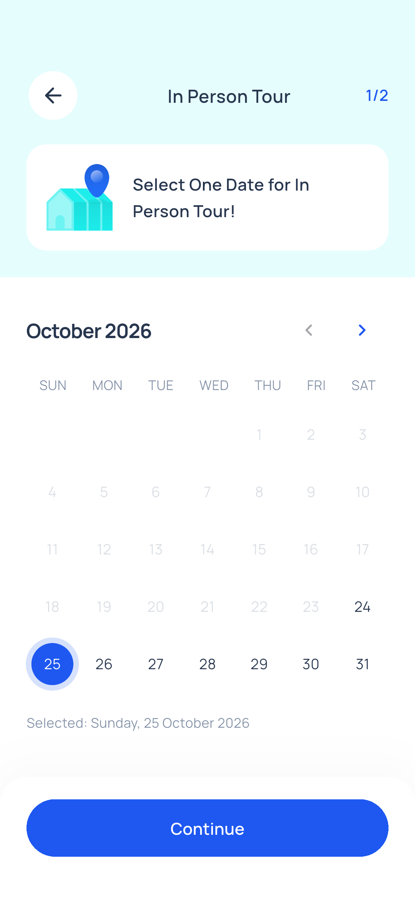
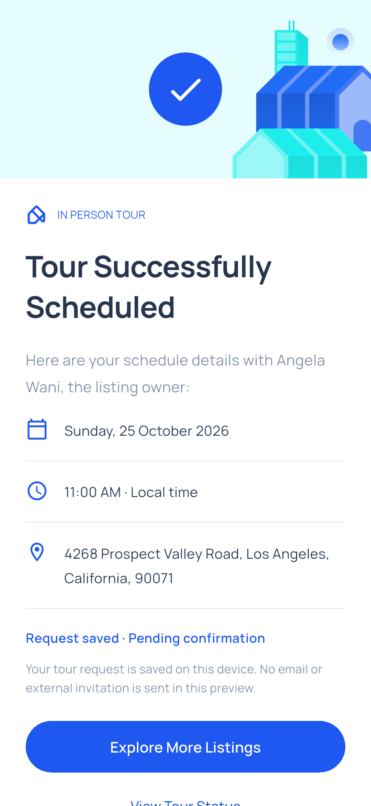
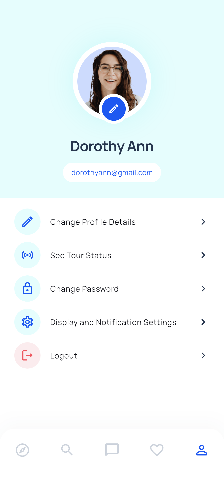
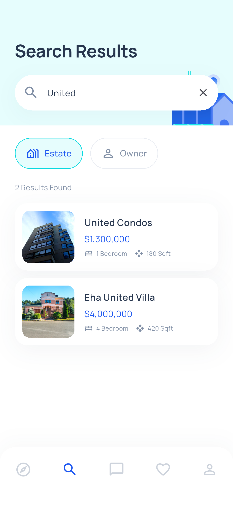
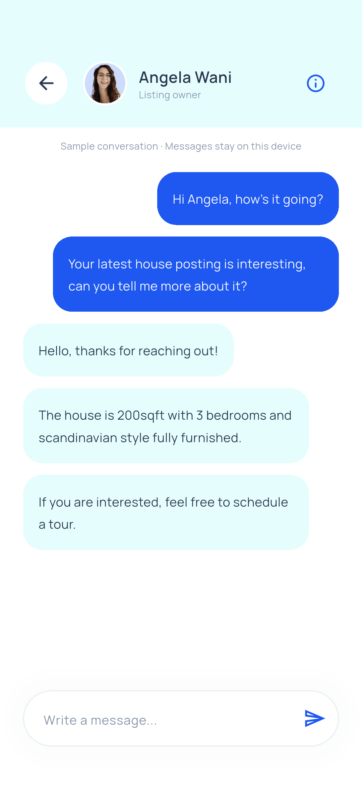
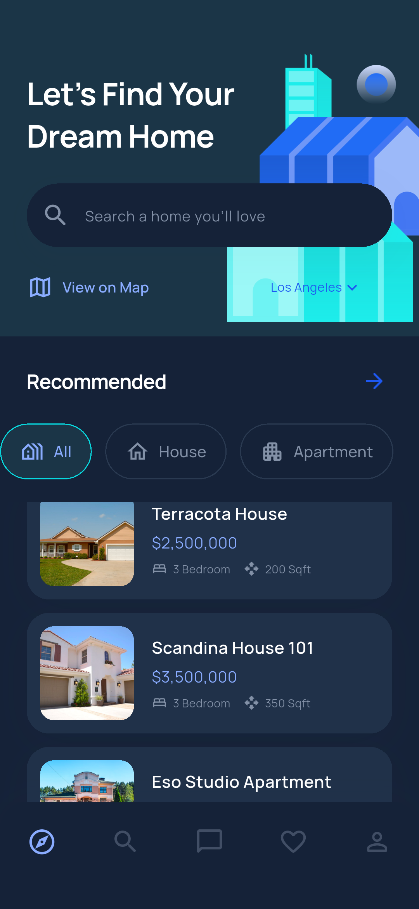
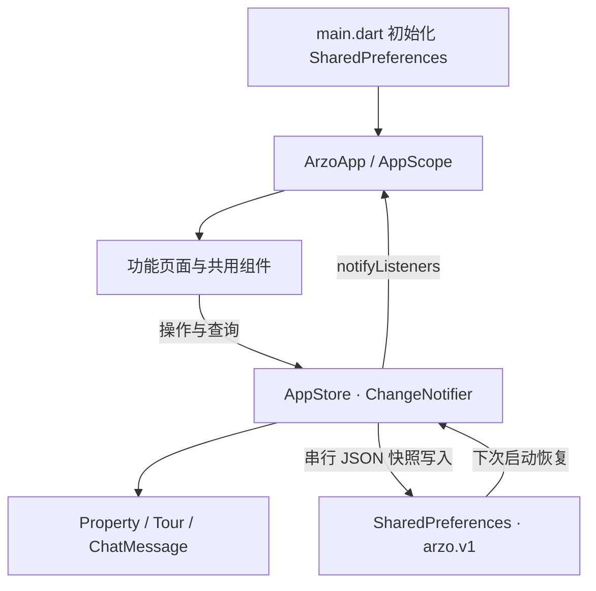

# Arzo Real Estate · Flutter 房产应用

根据 Pixso **Arzo - Real Estate App UI Kit** 开发的 Flutter 应用。使用原稿的 Manrope 字体、薄荷青背景、蓝色按钮、房源照片及建筑插画，提供完整的本地交互演示。

项目包含 Android、iOS、Web 工程。当前开发与模拟器验证环境为 Windows + Flutter 3.47.7 / Dart 3.13.5，Android 15（API 35）。

## 安装体验

- [Android 手机安装包（ARM64，21.9 MB）](dist/Arzo-1.0.0-arm64.apk)
- [Android 模拟器安装包（x64，23.4 MB）](dist/Arzo-1.0.0-x64.apk)

首次打开选择 **Skip → Explore as a Guest** 即可浏览。安装包使用本地体验签名，功能边界详见下文。

## 主要界面

以下图片为 Flutter 应用在 Android 模拟器中的实际运行截图，完整目录见 [各界面截图索引](docs/SCREENSHOTS.md)。

| 首页与分类 | 房源详情 | 房源相册 |
| --- | --- | --- |
|  |  |  |

| 日期选择 | 预约成功 | 个人中心 |
| --- | --- | --- |
|  |  |  |

| 搜索结果 | 房东聊天 | 深色首页 |
| --- | --- | --- |
|  |  |  |

## 功能范围

| 模块 | 已实现 |
| --- | --- |
| 引导与账户 | 三步引导、跳过、注册、社区选择、登录表单、游客进入、找回与重置密码界面 |
| 房源首页 | 推荐房源、All / House / Apartment 分类、地区切换、地区无房源状态 |
| 搜索 | 按房源名称、城市、房东搜索，Estate / Owner 切换，清空搜索与无结果状态 |
| 地图 | 原稿示意地图、可点击房源标记、选中房源卡片、按名称和分类过滤 |
| 房源详情 | 图片、价格、卧室等参数、地图位置、房东入口、展开介绍、示例估值比较 |
| 相册 | 三张图片、全屏查看、左右翻页、缩放 |
| 收藏 | 收藏 / 取消收藏、本地保存、滑动删除、删除确认与空状态 |
| 聊天 | 示例对话、发送本地消息、会话列表、输入过滤、记录保存 |
| 看房预约 | 线下 / 视频两条流程、联系方式、日历、时间、确认、成功反馈、预约列表、详情与取消 |
| 预约约束 | 过去日期与已过时间不可选，同一日期同一时段不可重复预约，取消后释放时段 |
| 个人资料 | 姓名 / 邮箱编辑与校验、示例头像 / 首字母切换、修改密码表单、退出确认 |
| 设置 | 浅色 / 深色主题切换、通知偏好、本地持久化 |

### 本地演示与服务边界

这是可运行的前端与本地状态演示工程，没有连接业务后端：

- 登录接受有效格式邮箱与至少 6 位的示例密码，也可直接点击 **Explore as a Guest**。密码不保存，不提供真实账户认证。
- 找回、重置和修改密码展示表单与反馈，不发送邮件，不修改任何真实账户。
- 房源、房东、市场比较、初始对话为示例数据；新发消息保存在当前设备，不投递给真实房东。
- 地图使用 Pixso 导出的静态底图与交互标记，没有定位、导航路线或地图服务请求。
- 预约保存在本机，初始为 **Pending confirmation**，可取消；不会联系房东、发送通知、建立 Zoom / WhatsApp 会话。
- 预约时间以设备本地时间为准。通知开关保存偏好，不注册推送服务。
- 本地资料、收藏、聊天和预约在当前安装内共用同一份演示数据，退出不会清除；不适用于多账户隔离或敏感数据存储。

## 项目结构

```text
ArzoRealEstate/
├── lib/
│   ├── main.dart                         # 初始化本地偏好、启动应用
│   ├── app.dart                          # 应用主题、启动状态、根页面
│   ├── core/
│   │   ├── theme.dart                    # 色彩、字体、浅深色主题
│   │   └── widgets.dart                  # 按钮、页头、表单、卡片、空状态
│   ├── data/
│   │   ├── models.dart                   # Property / Tour / ChatMessage、样例数据
│   │   └── app_store.dart                # 可观察状态、本地读写、业务规则
│   └── features/
│       ├── auth/                         # 引导、登录、注册、找回密码
│       ├── home/                         # 五栏主框架、首页、搜索、地区、地图、收藏
│       ├── property/                     # 房源详情、参数、相册、照片查看
│       ├── tours/                        # 预约向导、成功页、状态列表及详情
│       ├── messages/                     # 聊天列表与对话
│       └── profile/                      # 个人中心、编辑、密码、显示设置
├── assets/
│   ├── images/                           # Pixso 原稿导出的本地图片
│   └── fonts/                            # Manrope 与 OFL 字体许可证
├── test/app_store_test.dart               # 状态、保存、查询与预约规则测试
├── test/layout_test.dart                  # 小屏、键盘与空状态布局回归
├── integration_test/app_test.dart         # 模拟器端到端流程与截图
├── test_driver/integration_test.dart      # 将运行截图保存到文档目录
├── tool/generate_icons.ps1                # 使用原稿 Logo 生成各平台应用图标
├── docs/
│   ├── DESIGN.md                         # 设计节点、规范与实现映射
│   ├── SCREENSHOTS.md                    # 全部运行截图索引
│   ├── TESTING.md                        # 验证环境、结果、复现命令
│   ├── reference/                        # Pixso 原稿参考快照
│   └── screenshots/                      # Flutter 实际运行截图
├── android/                              # Android 原生宿主
├── ios/                                  # iOS 原生宿主
├── web/                                  # Web 宿主与品牌图标
├── dist/                                 # 可安装的 Android release APK
└── pubspec.yaml                          # Flutter 资源与依赖
```

## 架构与数据流

采用适合此规模的轻量分层：页面负责展示与短期交互，`AppStore` 负责共享状态和本地仓储，模型定义业务数据。没有引入额外状态管理、路由、网络或数据库框架。



### 状态划分

- **共享状态**：首次引导、演示登录、姓名邮箱、地区、头像偏好、主题、通知偏好、收藏、预约、聊天记录。
- **页面状态**：主导航选中项、搜索词、分类、地图选中房源、相册页码、表单内容、预约向导进度、日历月份。
- **静态内容**：`models.dart` 中五套示例房源、本地图片、品牌主题。

`AppScope` 通过 `InheritedNotifier` 向下提供 `AppStore`；页面调用状态方法后，`notifyListeners()` 更新展示。`ArzoApp` 根据引导与会话状态选择入口，根据主题偏好重建 `MaterialApp`。五个主导航页使用 `IndexedStack` 保留页面状态。

### 本地保存

`AppStore` 把用户状态序列化到 `arzo.v1`。每次修改先更新界面，再将不可变的 JSON 快照加入串行写入队列，避免连续操作导致旧状态覆盖新状态。重新构造 `AppStore` 会恢复资料、偏好、收藏、预约和本地消息。格式损坏的快照不会阻断应用启动。

`SharedPreferences` 适合本演示的小体量数据，不作为生产聊天数据库或认证凭证存储。生产环境可将 `AppStore` 中的持久化与查询方法替换为独立仓储及 API，保留页面组件和数据模型。

### 页面流转

```text
引导 → 登录 / 注册 → 选择社区 → 五栏主界面
                         ├─ 首页 → 地图 / 地区 / 房源详情
                         ├─ 搜索 → 房源 / 房东 → 详情 / 聊天
                         ├─ 消息 → 对话
                         ├─ 收藏 → 详情 / 删除确认
                         └─ 我的 → 资料 / 预约状态 / 密码 / 设置 / 退出

房源详情 → 相册 / 全屏图片 / 参数 / 位置 / 联系房东
         → 预约类型
             ├─ In Person → 日期 → 时间 → 确认 → 成功
             └─ Live Video → 联系方式 → 日期 → 时间 → 确认 → 成功
预约状态 → 详情 → 本地取消 / 联系房东 / 房源位置
```

使用 Flutter 原生 `Navigator` + `MaterialPageRoute`。预约的选择、日期、时间与确认共用一个有状态向导，避免每一步重复维护数据和页面模板。

## 启动与构建

```powershell
flutter pub get
flutter run -d emulator-5556
```

设备编号以 `flutter devices` 输出为准。首次进入会展示三步引导。若希望直接体验，点击 **Skip → Explore as a Guest**。

```powershell
# 静态检查与状态测试
flutter analyze
flutter test

# 在连接的 Android 设备上执行全部流程，并生成截图
# 注意：此测试会清除本应用的本地演示数据，不影响其他应用。
$env:ARZO_DEVICE='emulator-5556'
flutter drive --driver=test_driver/integration_test.dart --target=integration_test/app_test.dart -d emulator-5556 --no-dds

# Android 安装包，按 ABI 分包减小体积
flutter build apk --release --split-per-abi

# Web 预览 / 构建
flutter run -d chrome
flutter build web
```

iOS 源工程已准备；iOS 编译、签名与真机验证需要 macOS / Xcode，当前 Windows 环境未执行。Android release 使用项目模板的 debug 签名，供本地安装体验；正式分发需换成发布签名。

## 代码整理

- 共用按钮、页头、房源卡片、头像、表单、确认弹窗和空状态，减少页面间复制。
- 用同一套表单承载登录、注册、找回、重置；用同一向导承载两类预约。
- 原稿的空、填充、错误和选中画板用运行状态表达，不为每个画板生成重复页面。
- 运行时第三方依赖只有 `shared_preferences`；字体和图片全部本地化。
- 已移除 Flutter 默认计数器、样例测试与无用图标依赖，平台图标替换为 Arzo 品牌。
- 浅深主题共用页面，保留平台工程和必要资源，不把测试、原稿快照或文档打进应用资源包。

设计读取细节见 [DESIGN.md](docs/DESIGN.md)，验证记录见 [TESTING.md](docs/TESTING.md)。
